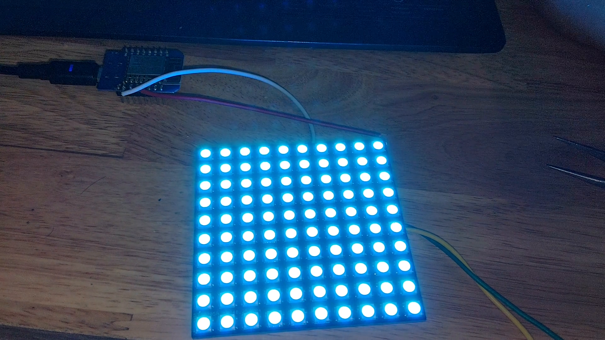

# WS2812B 10x10 RGB LED Matrix Panel - Hardware Release


A high-density, open-source **10x10 (100-pixel) addressable RGB LED matrix panel** engineered for compact digital signage, wearable displays, pixel art canvas, retro gaming visualizers, and smart notification dashboards.


> [!IMPORTANT]
> **Hardware only**:
> This repository only contains production Gerbers, schematic files, interactive BOM, CAD models, photos and videos.


---

## Overview

### 1. CAD Assembly & Render

#### Isometric

*(Placeholder: Place 3D CAD isometric render at `media/3d_render_iso.png`)*

#### Other views
| Top Side (LED Matrix & Orientation Silk) | Bottom Side (Power Bus & Decoupling MLCCs) |
|:---:|:---:|
|  |  |
| *(Placeholder: `media/3d_render_front.png`)* | *(Placeholder: `media/3d_render_back.png`)* |

---

### 2. Showcase

| Top Side (Mounted WS2812B LEDs) | Bottom Side (Routing, Caps & Connectors) |
|:---:|:---:|
|  |  |
| *(Placeholder: `media/real_build_front.jpg`)* | *(Placeholder: `media/real_build_back.jpg`)* |

| Hardware in Action (Full Dynamic Glow) | Close-up Detail (Decoupling & Solder Quality) |
|:---:|:---:|
|  |  |
| *(Placeholder: `media/real_build_action.jpg`)* | *(Placeholder: `media/real_build_closeup.jpg`)* |

---

### 3. Test run video 

Current v1.0 panel undergoing web serial canvas drawing test:

[](media/test_run.mp4)


---

## Features

- **100-Pixel High-Density Matrix ($10 \times 10$)**:
  - Populated with 100x genuine **WS2812B-5050** (or compatible 3535 / 2020) addressable RGB LEDs.
  - 24-bit TrueColor capability (16,777,216 distinct color shades).


---

## Technical specifications

| Parameter | Specification |
|:---|:---|
| **Dimensions** | 80mm x 80mm |
| **Grid Dimensions** | 10 Columns $\times$ 10 Rows (100 LEDs) |
| **LED Package** | 5050 SMD (5.0 x 5.0 mm) |
| **Pixel Pitch** | 8.0 mm  |
| **Operating Voltage ($V_{DD}$)** | 5.0V DC nominal ($4.5\text{V} - 5.5\text{V}$) |
| **Max current consumption** | 3A |
| **Connectivity** | Solder pads |
| **PCB Form Factor** | 2-Layer FR4, 1oz copper, 1.6mm thickness |

---


## Powering the panel
> [!WARNING]
> Always use an external **5V DC regulated power supply (at least 4A output) with a 220-2200uF electrolytic capacitor** in parallel to the power input, with common ground tied to the MCU.


---

## Schematic details

### 1. Circuit Schematic
The electrical schematic is provided in vector PDF format alongside high-resolution raster previews:
* **Vector PDF**: [`schematic/SCH_WS2812B_10x10_Panel.pdf`](schematic/SCH_WS2812B_10x10_Panel.pdf)
* **High-Resolution PNG**: [`schematic/SCH_WS2812B_10x10_Panel.png`](schematic/SCH_WS2812B_10x10_Panel.png)

*(Placeholder: Add your schematic exports to [`schematic/`](schematic/))*

---

### 2. Fabrication Packages (Gerbers & Drill Files)
Production packages prepared for PCB manufacturers (JLCPCB, PCBWay, OSH Park):
* **Ready-to-Order Gerbers**: [`gerbers/WS2812B_10x10_Gerber_v1.0.zip`](gerbers/WS2812B_10x10_Gerber_v1.0.zip)

#### Recommended PCB Manufacturing Specifications
* **Layers**: 2 Layers
* **PCB Thickness**: 1.6 mm
* **Base Material**: FR-4 ($T_g \ge 130^\circ\text{C}$)
* **Finished Copper Weight**: **2 oz (70 µm)** recommended for minimal thermal buildup and low voltage drop
* **Surface Finish**: HASL Lead-Free or ENIG (Electroless Nickel Immersion Gold)
* **Solder Mask Color**: Matte Black (optimal contrast for RGB displays)
* **Silkscreen**: High-contrast White with pinout indicators

*(Placeholder: Place zipped fabrication files into [`gerbers/`](gerbers/))*

---

### 3. Mechanical & 3D CAD Files
* **3D CAD STEP Assembly**: [`media/cad/3D_WS2812B_10x10_Panel.step`](media/cad/3D_WS2812B_10x10_Panel.step)

---

## Bill of Materials (BOM)

| Designator | Value / Part | Footprint / Package | Description | Qty |
|:---|:---|:---|:---|:---:|
| **LED1 – LED100** | WS2812B-5050 (or 2020/3535) | SMD 4-Pin 5050 | Intelligent Addressable RGB LED with built-in driver | **100** |
| **C1 – C100** | 100nF (0.1µF) 50V X7R | 0402 or 0603 SMD | Per-LED High-Frequency Decoupling Capacitor | **100** |
| **R1** | 330Ω – 470Ω ±1% | 0603 SMD | DIN Signal Line Damping / Protection Resistor | **1** |
| **C_BULK** | 1000µF 10V | Electrolytic Radial / SMD 8x10 | Main DC Input Filter & Surge Protection Capacitor | **1** |
| **D1** | SS34 / 1N5819 | SMA / SOD-123 | Reverse Polarity Protection Schottky Diode (Optional) | **1** |
| **J_IN** | 2.54mm 1x3P Male Header / JST-XH-3P | 2.54mm Pitch | Main Power & Data Input (`5V`, `DIN`, `GND`) | **1** |
| **J_OUT** | 2.54mm 1x3P Male Header / JST-XH-3P | 2.54mm Pitch | Cascade Output (`5V`, `DOUT`, `GND`) | **1** |
| **PWR_INJ** | Solder Pads / 2-Pin Screw Terminal | 5.0mm Pitch | Auxiliary Power Injection (`5V`, `GND`) | **1** |

---

## Microcontroller Hookup & Level Shifting

### 1. Wiring to a 5V Microcontroller (Arduino Uno, Mega, Leonardo)

```
 [ Arduino ]                       [ 10x10 LED Panel ]
  Pin 6 (Digital)  ---------------> DIN (Data In)
  GND              ------+--------> GND
                         |
 [ External 5V PS ]      |
  5V (Positive)   -------+--------> 5V (VCC)
  GND (Negative)  -------+
```

### 2. Wiring to a 3.3V Microcontroller (ESP8266, ESP32, RP2040)

WS2812B requires a logic high of at least $0.7 \times V_{DD} \approx 3.5\text{V}$ when powered at 5.0V. While 3.3V GPIO signals occasionally function over short wire runs, using a **74AHCT125** or **74HCT245** logic level shifter is strongly advised for stable operation.

```
 [ ESP8266 / ESP32 (3.3V) ]      [ 74AHCT125 Level Shifter ]       [ 10x10 LED Panel (5V) ]
   GPIO Pin (e.g. D2 / GPIO4) ---> 1A (Input)
                                  1Y (Output) --------------------> DIN (Data In)
                                  VCC ----------------------------> 5V Rail
                                  /1OE + GND ---------------------> GND
```

---

## License & Credits

- **Hardware Design**: Open-source hardware developed by **dolce_st**.
- **Documentation**: Prepared and verified for community hardware distribution.
- **License**: Released under the **[CERN Open Hardware Licence Version 2 - Strongly Reciprocal (CERN-OHL-P v2)](https://ohwr.org/cern_ohl)**.
