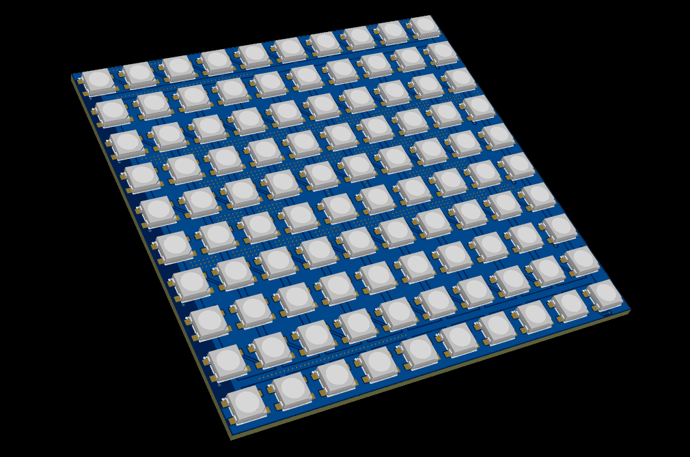
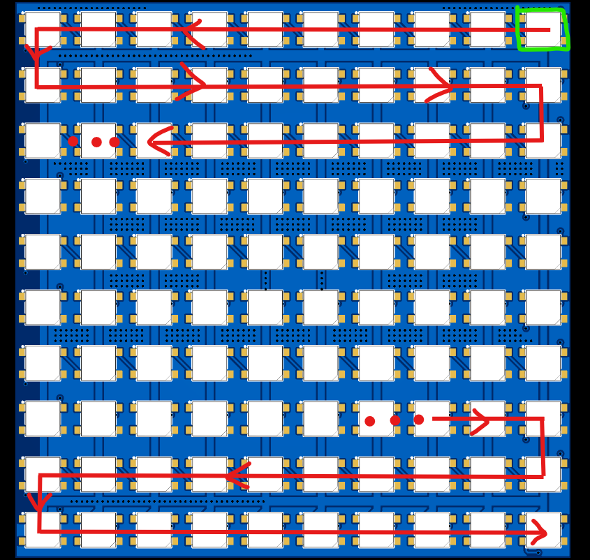
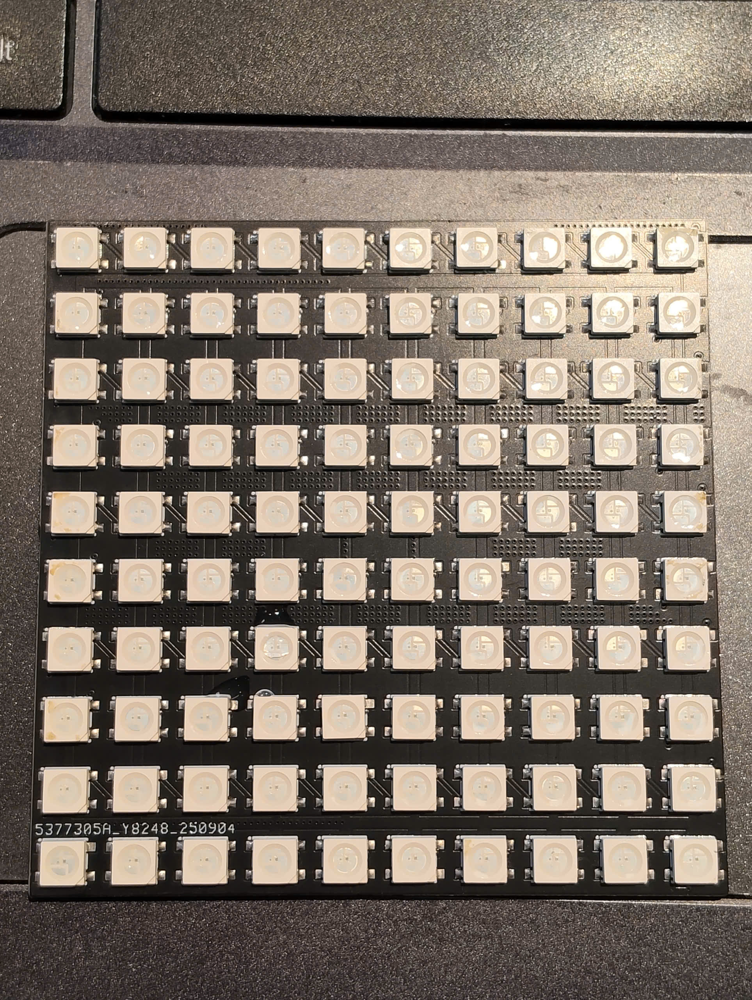
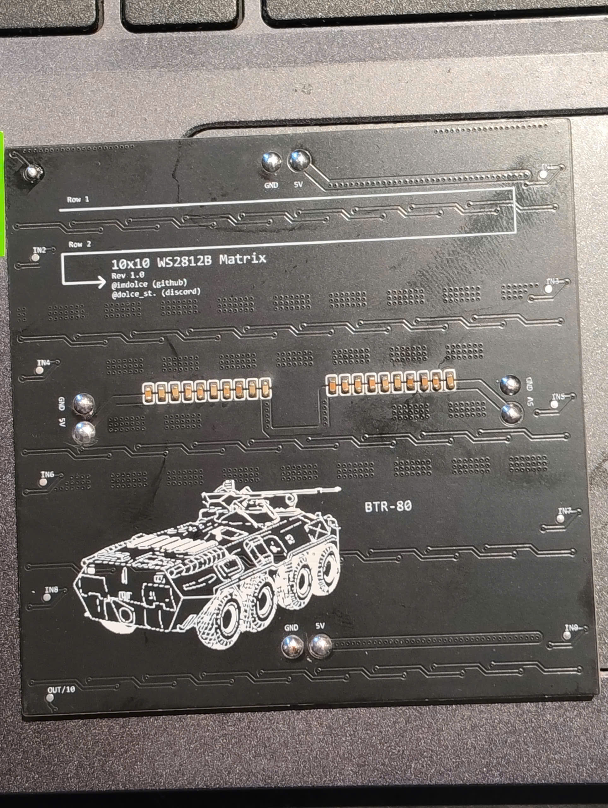

# WS2812B 10x10 RGB LED Matrix Panel


-orange.svg)


A simple, open-source **10x10 (100-pixel) addressable RGB LED matrix panel** using 5050 (5.0 x 5.0 mm) SMD LEDs on an 80 mm × 80 mm 2-layer PCB. Initially intended to be a some sort of fun badge/portable ornament screen gadget (you may encounter such panels on backpacks)

> [!IMPORTANT]
> This repository only contains production schematic files (v1.0 and v1.1), EasyEDA Pro Interactive BOM, 3D CAD models (STEP), fabrication specifications, high-resolution assembled board photos, routing diagrams, and test run video. 

> [!IMPORTANT]
> You'll notice that there's another version v1.1. In this version, the data line is split into 10 separate rows instead of 1 continuous serpentine track, aimed at easy panel scalability on the horizontal axis. Use thin jumper wires to connect the data lines between panels.

---

## Overview

### 1. 3D CAD Assembly & Routing Diagram

| Isometric view                                                 | Serpentine Data path                                                                                                                           |
|:--------------------------------------------------------------:|:----------------------------------------------------------------------------------------------------------------------------------------------:|
|  |                                                                                        |
| *3D isometric view of the 80x80mm 10x10 panel*                 | *Serpentine data routing (First LED starts at Top-Right `(Green square)`, data line direction `(Red arrow)` zigzags to Bottom-Right `OUT/10`)* |

---

### 2. Assembled Hardware

Fully assembled hardware build (Rev 1.0) in white silkscreen, showing the LED data direction array, author info and a BTR-80 (yes i play war thunder)

| Top Side (100x WS2812B-5050 LEDs)              | Bottom Side (Decoupling Array & Power Distribution)         |
|:----------------------------------------------:|:-----------------------------------------------------------:|
|  |         |
| *100× WS2812B 5050 SMD addressable RGB LEDs*   | *20× 0603 decoupling caps, 4× power terminal pairs, BTR-80* |

#### Features:

* **"Emotional support" decoupling capacitors**: Initially each LED was going to have their own decoupling capacitor, then I realized, ain't no way I'm doing allat. So I left 20 of them behind as emotional support.
* **Power Solder Points**: 4 pairs of  `5V` and `GND` solder points (Top, Middle-Left, Middle-Right, Bottom) allowing convenient power daisy-chaining between panels.
* **Row Test points**: 10 individual test points (`IN2` through `IN9`, `OUT/10`) for testing individual rows or custom matrix cascading.


---

### 3. Test Run Video

The assembled v1.0 panel driven by an ESP8266 (Wemos D1 mini) running a web serial canvas drawing test:

[](media/test_run.mp4)

* Click thumbnail above to download or open [`media/test_run.mp4`](media/test_run.mp4).

---

## Technical Specifications

| Parameter                    | Specification                                                               |
|:---------------------------- |:--------------------------------------------------------------------------- |
| **Board Dimensions (bare)**  | 80.0 mm × 80.0 mm × 1.6 mm                                                  |
| **Matrix Resolution**        | 10 Columns × 10 Rows (100 Addressable RGB Pixels)                           |
| **LED Package**              | WS2812B-HS01/W (5050 SMD 4-pin, Worldsemi / LCSC C22371521)                 |
| **Pixel Pitch**              | 8.0 mm center-to-center                                                     |
| **Operating Voltage**        | 5.0V DC nominal (4.5V – 5.5V)                                               |
| **Data Signal Logic Level**  | 5V TTL is recommended. Does work with 3.3V logic.                           |
| **Peak Current Consumption** | ~3.0A – 3.5A (all pixels at 100% white, full brightness)                    |
| **Decoupling MLCCs**         | 20× 100nF 50V X7R (0603 SMD), centralized dual-bank layout                  |
| **Power Connections**        | 4× distributed 5V & GND solder pad pairs (Top, Mid-left, Mid-right, Bottom) |
| **Row Test points**          | 10× 0.5 mm pads (`IN2`–`IN9`, `OUT/10`)                                     |
| **PCB**                      | 2-Layer FR-4, 1.6 mm thickness, 1 oz copper                                 |

---

## Matrix Mapping & Data Flow

The matrix utilizes a **horizontal serpentine (zigzag) layout**, beginning at the **top-right** corner when viewed from the front:

```
(Front View)
Col:   9    8    7    6    5    4    3    2    1    0
     +------------------------------------------------+
Row 0|  9 <---------------------------------------- 0 | <-- DIN (Data In)
Row 1| 10 ----------------------------------------> 19 |
Row 2| 29 <--------------------------------------- 20 |
Row 3| 30 ----------------------------------------> 39 |
Row 4| 49 <--------------------------------------- 40 |
Row 5| 50 ----------------------------------------> 59 |
Row 6| 69 <--------------------------------------- 60 |
Row 7| 70 ----------------------------------------> 79 |
Row 8| 89 <--------------------------------------- 80 |
Row 9| 90 ----------------------------------------> 99 | --> DOUT (OUT/10)
     +------------------------------------------------+
```


---

## Schematic & CAD Files

### 1. Circuit Schematic

The electrical schematic is provided in vector PDF format and high-resolution PNG previews:

* **Schematic v1.1 (Updated Net / Test Point Labeling)**:
  * Vector PDF: [`schematic/SCH_5050-v1.1_2026-10-26.pdf`](schematic/SCH_5050-v1.1_2026-10-26.pdf)
  * Preview Image: [`schematic/SCH_5050-v1.1_1-P1_2026-10-26.png`](schematic/SCH_5050-v1.1_1-P1_2026-10-26.png)
* **Schematic v1.0 (Production Release / Rev 1.0)**:
  * Vector PDF: [`schematic/SCH_5050-v1_2026-10-26.pdf`](schematic/SCH_5050-v1_2026-10-26.pdf)
  * Preview Image: [`schematic/SCH_5050-v1_1-P1_2026-10-26.png`](schematic/SCH_5050-v1_1-P1_2026-10-26.png)

### 2. Interactive Assembly BOM

* **EasyEDA Pro Interactive BOM**: [`schematic/InteractiveBOM_PCB2_2026-10-26.html`](schematic/InteractiveBOM_PCB2_2026-10-26.html)

### 3.  CAD files

* **STEP 3D Assembly**: [`cad/3D_5050-v1_2026-10-26.step`](cad/3D_5050-v1_2026-10-26.step)
  * Fully featured 3D CAD model suitable for CAD designs.

### 4. PCB Fabrication & Gerbers

Fabrication parameters recommended for JLCPCB, PCBWay, or OSH Park:

* **Directory**: [`gerbers/`](gerbers/)
* **Layers**: 2 Layers
* **PCB Thickness**: 1.6 mm
* **Base Material**: FR-4
* **Finished Copper Weight**: 1 oz
* **Surface Finish**: Any
* **Solder Mask Color**: Any
* **Silkscreen Color**: White

---

## Bill of Materials (BOM)

| Designator            | Value / Part          | Footprint      | Description                                                    | Note                              | Qty     |
|:--------------------- |:--------------------- |:--------------:|:-------------------------------------------------------------- |:---------------------------------:|:-------:|
| **U1 – U100**         | WS2812B-V6            | SMD 4-Pin 5050 | Addressable RGB LED with built-in control IC                   | Any WS2812B compatible LEDs work. | **100** |
| **C81 – C100**        | 100nF (0.1µF) 50V X7R | 0603           | Central high-frequency power decoupling MLCC capacitors        | Can be omitted.                   | **20**  |
| **IN1 – IN9, OUT/10** | Test-Point-0.5mm      | -              | Row signal injection and test tap pads                         | -                                 | -       |
| **5V / GND (x4)**     | Power Solder Pads     | -              | Distributed power injection points (Top, Mid-L, Mid-R, Bottom) | -                                 | **8**   |

### Additional components

* **Bulk filter capacitor**: 1000 µF (10V or 16V) low-ESR electrolytic capacitor across 5V and GND close to the board input.
* **Data input resistor (not necessary but recommended)**: 330 Ω – 470 Ω (0.25W) resistor in series on the data line near the microcontroller.
* **Logic level shifter (not necessary but recommended)**: 74AHCT125 or 74HCT245 when interfacing with 3.3V microcontrollers (ESP8266, ESP32, RP2040, Raspberry Pi).

---

## License & Credits

- **Hardware Design**: Designed and created by **[dolce_st](https://github.com/imdolce)** (`@imdolce` on GitHub, `@dolce_st.` on Discord).
- **Hardware License**: Released under the **[CERN Open Hardware Licence Version 2 - Strongly Reciprocal (CERN-OHL-P v2)](https://ohwr.org/cern_ohl)**.

- **Documentation**: Template by Google Gemini, proofread & edited and corrected by `dolce_st`.
